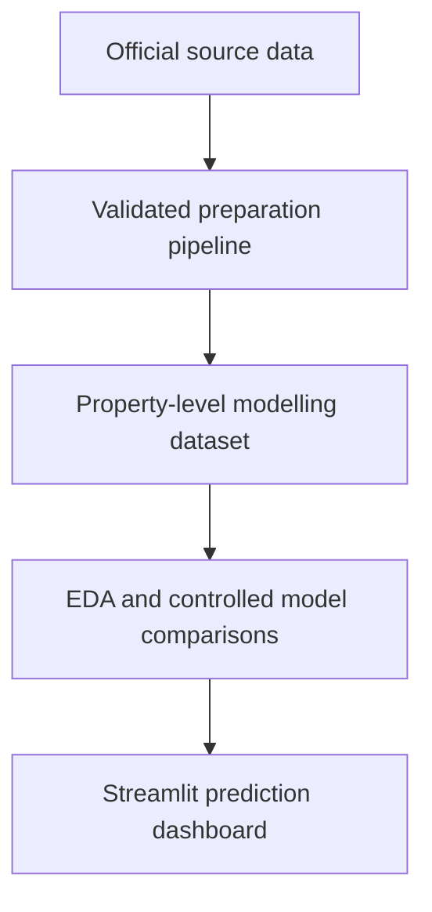

# Predicting Bristol house prices using machine learning and socio-economic data

This MSc Data Science artefact combines HM Land Registry transactions, Police.uk street-crime records, Nomis claimant data and official postcode geography. It evaluates whether neighbourhood crime and socioeconomic conditions improve Bristol house-price predictions beyond basic property and time information.

## Research question

> Can adding local crime, socioeconomic and property-related features improve the accuracy of machine-learning house-price predictions in Bristol compared with using basic Land Registry property data alone?

## Artefact components



The artefact contains:

- reproducible data preparation and validation scripts;
- a validated dataset of 21,968 Bristol transactions from 2022–2024;
- exploratory analysis and charts;
- linear regression, random-forest and gradient-boosting comparisons;
- a one-month-lagged leakage sensitivity analysis;
- the selected lagged enriched random-forest model;
- a small Streamlit dashboard;
- data, methodology, ethics, results and reproduction documentation.

## Main result

The selected lagged enriched random forest was evaluated on 5,885 unseen 2024 Category A transactions. Its mean absolute error was £99,655, compared with £124,634 for the property-only random forest on the same cohort: a 20.0% reduction. Price-scale R² increased from 0.138 to 0.431.

This shows that the neighbourhood variables add predictive information within this design. It does not establish that crime or claimant conditions cause house prices to change.

## Quick start

Python 3.12 is recommended.

```bash
python -m venv .venv
```

Activate the environment, then install the fixed dependencies:

```bash
python -m pip install -r requirements.txt
```

Validate the included artefact:

```bash
python run_project.py --stage validate
```

Start the dashboard:

```bash
python run_project.py --stage dashboard
```

The terminal will display the local dashboard address, normally `http://localhost:8501`.

## Reproduce the analysis

The included processed data is sufficient to recreate the EDA, modelling comparisons and dashboard inputs:

```bash
python run_project.py --stage eda
python run_project.py --stage models
python run_project.py --stage dashboard-data
```

Run every included analysis stage in sequence with:

```bash
python run_project.py --stage all
```

The modelling stages refit several candidate models and may take several minutes. The 2024 records remain a chronological holdout and are not used for model tuning.

## Repository structure

| Path | Purpose |
|---|---|
| `analysis/` | EDA, modelling, sensitivity and dashboard-preparation scripts |
| `dashboard/` | Streamlit interface, prediction module and dashboard data |
| `docs/` | Data dictionary, methodology, results, sources, ethics and reproduction guidance |
| `models/` | Selected deployable lagged random-forest model |
| `outputs/` | Final dataset, feature tables, charts, metrics and validation records |
| Project-root preparation scripts | Raw-source preparation and validation pipeline |
| `tests/` | Dashboard and artefact tests |
| `verified_sources/` | Included official lookup/boundary and compact Nomis extracts |

## Documentation

- [Project scope](docs/PROJECT_SCOPE.md)
- [Data sources](docs/DATA_SOURCES.md)
- [Data dictionary](docs/DATA_DICTIONARY.md)
- [Methodology](docs/METHODOLOGY.md)
- [Results summary](docs/RESULTS_SUMMARY.md)
- [Ethics and limitations](docs/ETHICS_AND_LIMITATIONS.md)
- [Reproducibility](docs/REPRODUCIBILITY.md)
- [Dashboard evidence](dashboard/ARTEFACT_EVALUATION.md)

## Scope

The dashboard supports historical estimates for January–December 2024, the independently tested holdout period. It is an academic research artefact, not a current professional valuation, mortgage decision or recommendation to buy or sell property.
